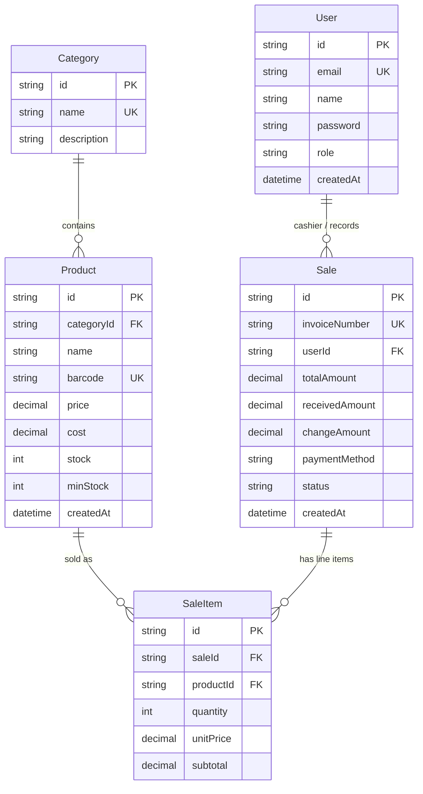

# 🛒 CDL Simple POS (Point of Sale) Web Application
**Cambodia Digital Literacy (CDL) — Final Project**  
*Built with Next.js (App Router), Neon PostgreSQL, Prisma ORM, and Vercel.*

---

## 🇰🇭 សេចក្តីសង្ខេបគម្រោង (Project Summary in Khmer)
គម្រោង **Simple POS (ប្រព័ន្ធលក់ទំនិញ)** នេះ ត្រូវបានបង្កើតឡើងសម្រាប់ឆ្លើយតបនឹងតម្រូវការជាក់ស្តែងរបស់អាជីវកម្មខ្នាតតូច ហាងលក់រាយ និងម៉ាត។
ប្រព័ន្ធនេះដំណើរការពេញលេញចាប់ពី៖
1. **ផ្ទាំងគ្រប់គ្រងទូទៅ (Dashboard):** បង្ហាញទិន្នន័យចំណូលសរុបប្រចាំថ្ងៃ សរុបប្រចាំខែ ចំនួនទំនិញ និងទំនិញជិតអស់ពីស្តុក (Low-stock Alert)។
2. **ផ្ទាំងគិតលុយលឿន (POS Terminal):** ស្វែងរកទំនិញ ឬស្កេនបាកូដ, បន្ថែមចូលកន្ត្រក, គណនាប្រាក់អាប់, ជ្រើសរើសការទូទាត់ (សាច់ប្រាក់ Cash / Bakong KHQR / កាត Card)។
3. **កាត់ស្តុកស្វ័យប្រវត្តិ (Auto-Deduct Stock):** រាល់ពេលលក់រួចរាល់ ចំនួនទំនិញក្នុងស្តុកនឹងត្រូវកាត់បន្ថយដោយស្វ័យប្រវត្តិក្នុង Neon Database។
4. **បោះពុម្ពវិក្កយបត្រ (Print PDF Receipt):** អាចបោះពុម្ពវិក្កយបត្រភ្លាមៗក្រោយទូទាត់រួច។
5. **គ្រប់គ្រងទំនិញ (Product CRUD):** បង្កើត កែប្រែ លុប និងស្វែងរកទំនិញជាមួយ Pagination។
6. **របាយការណ៍ និងទាញយកទិន្នន័យ (Reports & Export):** មើលស្ថិតិនៃការលក់ និងអាច Export ជាឯកសារ CSV/Excel បាន។

---

## 🛠️ Tech Stack & Requirements Coverage

| Layer | Technology | Details |
| :--- | :--- | :--- |
| **Framework** | **Next.js 16 (App Router)** | Full-stack with Server Actions & Route Handlers, responsive on mobile & desktop |
| **Database** | **Neon (PostgreSQL)** | Cloud Serverless PostgreSQL with 5 relational tables |
| **ORM** | **Prisma 6 & Neon Serverless Driver** | Type-safe queries, connection pooling, and migrations |
| **Authentication** | **JWT & Bcrypt** | Secure password hashing, login/register flow |
| **Deployment** | **Vercel** | Production build verified with zero errors |

---

## 🗄️ Database Architecture & ERD (Entity Relationship Diagram)



---

## 📄 Application Pages (Routes)

1. **`/login` & `/register`**: Cashier & Admin authentication.
2. **`/dashboard`**: High-level sales metrics, KPI summary, top-selling products, and payment channel breakdown.
3. **`/pos`**: Full cashier screen with barcode scanner, live cart, change calculator, Bakong KHQR preview, and auto-stock deduction.
4. **`/products`**: Full CRUD interface for catalog items, low-stock visual badges, category filter, search, and pagination.
5. **`/sales`**: Detailed transaction archives with searchable invoice IDs and printable receipt modal.
6. **`/reports`**: Analytics charts and instant CSV export.

---

## 🚀 Getting Started Locally

### 1. Clone the repository
```bash
git clone <your-repo-url>
cd simple-pos
```

### 2. Install dependencies
```bash
npm install
```

### 3. Environment Variables Setup
Create a `.env` file in the root directory:
```env
DATABASE_URL="your-neon-postgres-connection-string"
JWT_SECRET="your-jwt-secret-key"
```

### 4. Seed Database with Initial Data
```bash
node scripts/seed.mjs
```

### 5. Run Development Server
```bash
npm run dev
```
Open [http://localhost:3000](http://localhost:3000) in your browser.

### Default Login Credentials:
- **Email:** `admin@pos.com`
- **Password:** `admin123`
